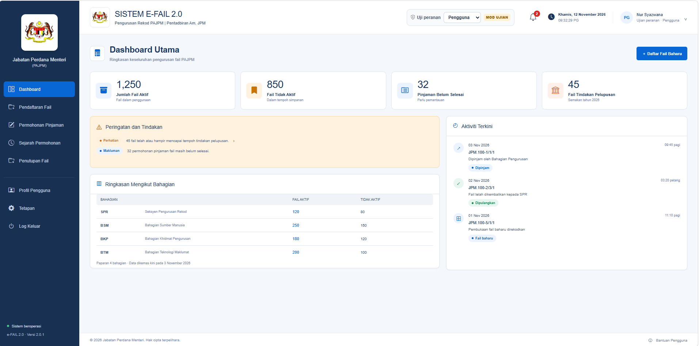
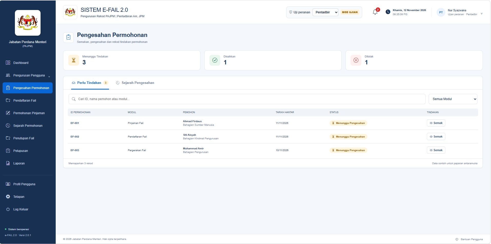
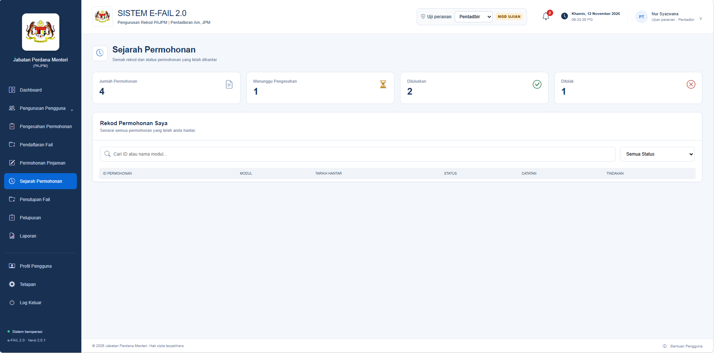

# e-FAIL – Digital File Management System

A web-based digital file management system designed to improve file registration, management, borrowing, tracking and administrative processes.

## About the Project

e-FAIL is a digital file management system developed to support more organised and efficient records management.

The system aims to provide a centralised interface for users to manage file-related requests and monitor file activities.

This project is currently under frontend development, with backend integration planned.

## Technologies Used

### Current Frontend
- HTML5
- CSS3
- JavaScript
- Bootstrap
- Bootstrap Icons

### Planned Backend
- PHP
- Laravel
- MySQL

## Main Modules

- Dashboard
- Pengurusan Penguna
- Pengesahan Permohonan
- Pendaftaran Fail
- Permohonan Fail
- Sejarah Permohonan
- Penutupan
- Perlupusan
- Laporan

## Key Objectives

- Improve digital file management.
- Simplify file-related requests.
- Improve file tracking and monitoring.
- Provide a user-friendly interface.
- Support more efficient records management.

## Project Status

**Current stage:** Frontend Development

Future development:
- Laravel backend integration
- MySQL database implementation
- User authentication and role management
- Request processing and approval workflows
- Organisation SSO integration (subject to technical requirements)

## Developer

**Developed by:** Muhammad Hakim

**Field:** Information Management

**Project Type:** Web Application
## System Screenshots

### Dashboard

### Pengesahan

### Carian

---

*This project is developed for learning and software development portfolio purposes. Any organisation-owned code or confidential information must not be shared publicly without permission.*
## Current Prototype Workflow

- Umum and Peribadi file records are stored separately.
- All user requests share the `efailRequests` approval queue.
- A file or volume record is created/updated only after Pentadbir approval.
- Loan and return status changes are recorded as `Tersedia` / `Dipinjam` transitions.
- Sejarah Permohonan is filtered to the current demo user.
- Laporan reads the combined Masterlist view; the Masterlist does not duplicate source records.

The prototype uses browser `localStorage` only. It is not yet connected to Laravel, MySQL or Government SSO.
